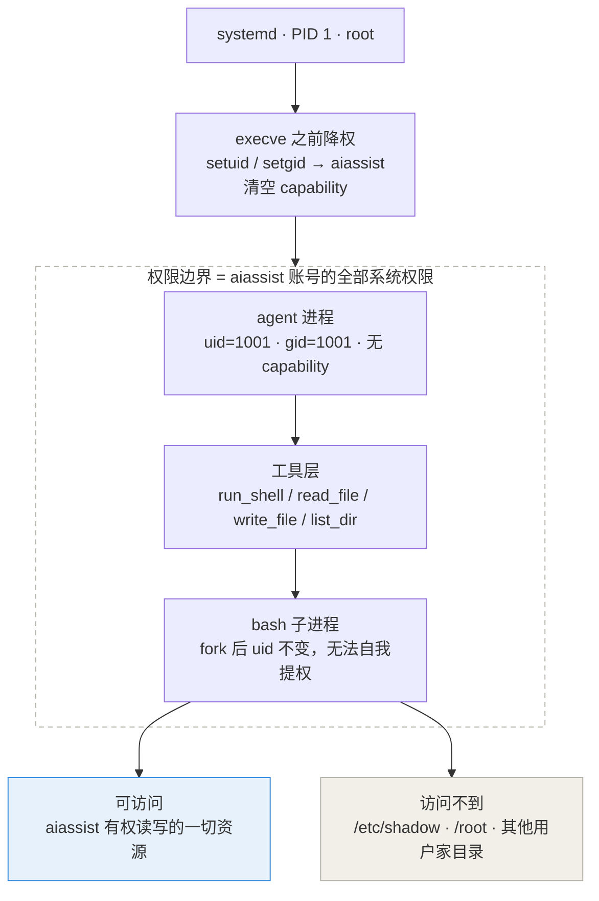

# linux-ai-agent

**给 AI 助手一个 Linux 账号，而不是一份权限清单。**

把 AI Agent 部署成服务器上一个真实的系统用户：它能做的每一件事，都恰好等于这个账号在系统里的权限 —— 不多一分，也不少一分。


> **English TL;DR** — Deploy an LLM-driven ops assistant as a **dedicated Linux service account**.
> Instead of bolting a command blacklist onto a root process, the privilege boundary is enforced
> by the kernel: `systemd` drops to `uid=aiassist` before `execve()`, and every child process
> inherits it. What the agent can touch is exactly what that account can touch.

---

## 目录

- [为什么不是"给 root + 黑名单"](#为什么不是给-root--黑名单)
- [权限模型](#权限模型)
- [快速开始](#快速开始)
- [三种部署形态](#三种部署形态)
- [关键实现](#关键实现)
- [安全清单](#安全清单)
- [Roadmap](#roadmap)

---

## 为什么不是"给 root + 黑名单"

大多数"AI 运维助手"的实现长这样：一个用 root 跑的进程，挂上 `run_shell` 工具，再在代码里塞一堆

```python
if "rm -rf" in command or "mkfs" in command:
    return "拒绝执行"
```

这种设计的问题不在黑名单写得不全，而在**位置错了**：护栏写在应用层，而应用层是可以被绕过的。变量拼接、base64、`$IFS`、换个等价命令……绕过之后，进程手里仍然是 root。

正确的做法是把边界下沉到内核：

> 不给助手 root，也不给它 sudo。
> 给它一个账号，让它用这个账号去干活。

进程以 `uid=aiassist` 运行后，`open()`、`execve()`、`kill()`、`connect()` 每一次系统调用都会用这个 uid 去查权限位。绕过应用层护栏的后果，从"服务器沦陷"降级为"被内核 `EACCES` 打回"。

黑名单不是不能有，但它的定位应该从**安全边界**降级为**防手滑**。

---

## 权限模型



关键在第二步：`systemd` 以 root 启动服务，但在真正的 `execve()` 之前完成 `setuid` / `setgid`，并清空补充组与 capability。**此后没有任何一步"把权限加回来"** —— 助手进程、它调用的工具层、它派生的每一个 `bash`，都共用同一个 uid。

验证方式（服务起来后跑一次）：

```bash
sudo -u aiassist /home/aiassist/agent/.venv/bin/python /home/aiassist/agent/agent.py --identity
# {"user":"aiassist","uid":1001,"gid":1001,"groups":["aiassist"],"sudo_allowed":false,...}

systemctl show ai-agent -p User -p Group -p CapabilityBoundingSet -p NoNewPrivileges
```

---

## 快速开始

```bash
# 1. 放到服务器上
git clone <your-repo> /opt/linux-ai-agent && cd /opt/linux-ai-agent

# 2. 建账号 + 装环境 + 起服务（幂等，可重复执行）
sudo AGENT_USER=aiassist bash setup.sh

# 3. 填 API Key（配置文件权限 0640 root:aiassist）
sudo vi /etc/ai-agent/agent.env

# 4. 观察
systemctl status ai-agent
journalctl -u ai-agent -f
```

投递任务：

```bash
# 一次性
sudo -u aiassist /home/aiassist/agent/.venv/bin/python \
  /home/aiassist/agent/agent.py --task "看看磁盘还剩多少空间，把结论写到 report.txt"

# 常驻模式：往收件箱丢一个 .task 文件即可，结果输出为同名 .out.json
echo "统计 /var/log 下最大的 5 个文件" \
  | sudo -u aiassist tee /home/aiassist/agent/inbox/$(date +%s).task
```

---

## 三种部署形态

| 形态 | 做法 | 权限范围 | 适用场景 |
|---|---|---|---|
| **A. 专属服务账号**（推荐） | `useradd aiassist` + systemd `User=aiassist` | 该账号的权限，可精确控制 | 生产环境、长期运行 |
| **B. 占用已有用户** | `systemd --user` 用户级服务 | 该用户的**全部**权限 | 助手需完全等同于某个操作员 / CI 账号 |
| **C. 容器内映射 UID** | `docker run --user 1000:1000` | 宿主同 UID 的权限 | 需要可复现环境、愿意多一层隔离 |

形态 B 是最贴近"让助手占据一个用户"字面要求的做法：

```bash
sudo -u deploy -H bash -c 'mkdir -p ~/.config/systemd/user && cp ai-agent-user.service ~/.config/systemd/user/ai-agent.service'
sudo -u deploy -H systemctl --user enable --now ai-agent
sudo loginctl enable-linger deploy     # 漏了这步，用户一注销服务就没了
```

注意用户级单元里**不能**写 `User=` / `Group=` —— 它本来就运行在该用户身份下。

---

## 关键实现

### 1. 工具层是唯一的出口

模型无法直接接触系统，所有动作都必须经过 `agent/tools.py` 里注册的四个工具。把副作用收敛到一个文件，是让整套设计可审计的前提。

```python
def run_shell(command: str, timeout: int = DEFAULT_TIMEOUT) -> ToolResult:
    for bad in FORBIDDEN:                        # 黑名单：防手滑，不是安全边界
        if bad in command.lower():
            return ToolResult(False, "被安全策略拒绝")

    proc = subprocess.run(
        ["/bin/bash", "-lc", command],
        cwd=str(WORKSPACE), capture_output=True, text=True, timeout=timeout,
        env=_clean_env(),                        # 剥离环境变量，避免 API Key 泄漏给子进程
    )
    _audit("run_shell", {"command": command}, proc.returncode == 0, proc.stdout + proc.stderr)
    return ToolResult(proc.returncode == 0, proc.stdout + proc.stderr)
```

### 2. 应用层补一道系统权限管不到的墙

账号权限决定了助手**能不能读 `~/.ssh`**，但决定不了它**该不该读**。所以文件类工具额外做一次路径圈禁：

```python
def _confine(raw: str) -> Path:
    path = (WORKSPACE / raw).resolve() if not os.path.isabs(raw) else Path(raw).resolve()
    if path != WORKSPACE and WORKSPACE not in path.parents:
        raise ValueError(f"路径越界：{path} 不在工作区 {WORKSPACE} 内")
    return path
```

这是**纵深防御**：系统权限是第一道，路径圈禁是第二道，审计日志是第三道。

### 3. 审计日志

每条工具调用记录 时间戳 / 操作者 uid / 工具名 / 完整参数 / 是否成功 / 退出码，以 JSONL 追加写入 `logs/audit.log`。出事后能完整复盘"模型当时到底做了什么"。

### 4. 身份自检

`--identity` 子命令打印当前进程的 uid、gid、所属组、sudo 状态。部署后第一件事就该跑它 —— 如果输出不是 `aiassist`，说明降权没生效。

---

## 安全清单

- [ ] **不要给 `sudoers` 加 `ALL`**。只写绝对路径的具体命令，改完必须 `visudo -c` 校验。
- [ ] **密钥不进代码**。走 `EnvironmentFile`（0640 root:aiassist）；更高要求可用 systemd `LoadCredential=` 通过文件描述符注入。
- [ ] **审计日志纳入轮转**，避免撑满磁盘，也避免被助手自己删掉（日志目录对 aiassist 只给写权限即可）。
- [ ] **高危动作加人审**。写系统目录、操作服务这类动作，在 `--serve` 模式下先落 pending 文件，人工确认后再执行。
- [ ] **定期轮换凭证**。助手账号一旦失陷，攻击面 = 该账号的权限面，这是它唯一的、也是最可靠的止损线。
- [ ] **`ProtectHome=read-only` 与 `ReadWritePaths=` 的交互**在不同 systemd 版本上行为不一致；如果服务报 `Read-only file system`，把 `ProtectHome` 改成 `no`。

---

## Roadmap

> 项目持续迭代中，以下按优先级排列。

**v0.2 — 可用性**
- [ ] 补齐 `pytest` 单元测试（工具层路径圈禁、黑名单、审计写入）
- [ ] `--serve` 模式的 pending 审批流程（高危动作人工放行）
- [ ] 支持流式输出与任务取消

**v0.3 — 安全加固**
- [ ] 可选 `bubblewrap` / `systemd-run --scope` 二次沙箱
- [ ] 基于 `seccomp` 的系统调用白名单
- [ ] 密钥改用 `LoadCredential=` 注入
- [ ] 审计日志结构化输出 + 越权告警

**v0.4 — 接入与观测**
- [ ] 任务来源适配器：HTTP 接口 / Redis 队列 / 企业微信机器人
- [ ] Prometheus 指标（任务数、耗时、拒绝率）
- [ ] 多助手共存：按账号划分能力边界

**长期**
- [ ] 面向 K8s 的版本（以 ServiceAccount + RBAC 替代 Linux 账号模型）
- [ ] 权限推荐器：根据历史任务自动生成最小 sudoers 白名单

---

## 目录结构

```
linux-ai-agent/
├── setup.sh                        # 幂等安装：建账号 → venv → 配置 → systemd
├── requirements.txt
├── agent/
│   ├── agent.py                    # 主循环：LLM 调用 → 工具执行 → 结果回灌
│   ├── llm.py                      # OpenAI 兼容客户端（唯一网络出口）
│   └── tools.py                    # 工具层 + 审计 + 路径圈禁 + 环境隔离
├── deploy/
│   ├── ai-agent.service            # 系统级单元（形态 A）+ 沙箱硬化项
│   ├── ai-agent-user.service       # 用户级单元（形态 B）
│   └── sudoers.d-ai-agent          # 受限提权白名单模板
├── config/
│   └── agent.env.example
└── docs/
    └── github-meta.md              # 仓库简介 / Topics / 迭代记录
```

---

## 项目状态

**v0.1 · 参考实现。** 这套代码的目标是把权限模型讲清楚并跑通，而不是提供一个开箱即用的产品。它在单机上经过验证，但尚未覆盖多租户、高并发、跨发行版兼容等场景。欢迎 issue 与 PR。

## 部署细则

更详细的部署说明、systemd 单元逐项解释、排错记录见 [`docs/DEPLOY.md`](docs/DEPLOY.md)。

## License

[MIT](LICENSE)
